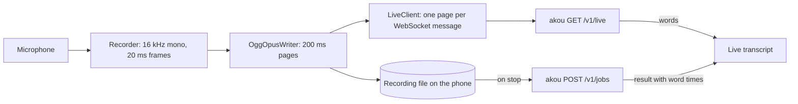

# Design and milestones

akou-companion is a thin iPhone recorder for an [akou](https://github.com/GeiserX/akou) server you run. The phone records and keeps the recording; the server does the recognition. Live text comes from the server's streaming recognizer over one WebSocket ([PROTOCOL.md](PROTOCOL.md)), and the final transcript from an ordinary akou job when the recording stops.

It works with any akou server. It needs a URL and an `ak_` key from the server's Keys page or `akou keys create`.

It is not a call recorder, an on-device transcriber or a hosted service, and nothing goes through a third party.

## How the pieces fit

- **AkouKit** (this repository's Swift package, tested with `swift test` on a Mac): `AkouProtocol` holds the message types, `AkouOpus` the libopus encoder and the Ogg page writer, `AkouClient` the live client and the server probe.
- **The app** (`App/`, generated with XcodeGen): the recorder, the transcript view, the uploader, the recordings list and the settings.
- **The widget extension**: the Live Activity, the record control for the Action button, the Lock Screen and Control Center, and the recent-recordings widget. It holds no key and makes no network request: the record intents run in the app process, and the widget reads only the App Group snapshot.

## Milestones

Each milestone ships on its own and ends with a measurement.

### M0: the server door, proven without a phone

akou gains `GET /v1/live`, Opus decoding on the live path, `capabilities.live` in `GET /v1/server`, and jobs that keep their audio. A command-line client streams a file at real-time pace. Measured: first-word latency, how far the last word lags the audio, bytes per hour, and live accuracy at 16, 24 and 32 kbit/s against PCM.

### M1: the app on TestFlight, in the foreground

Settings (URL, key in the Keychain, a test button), a big record button, the live transcript, the recordings list, the upload with an idempotency key, the final transcript with tap-to-seek on the local file. The local file is kept until the server confirms it kept the audio. Measured on a real phone, at home and on cellular: speech-to-screen lag, data per hour, and a 30-second airplane-mode gap that the final transcript fills.

### M2: background, one press to start, Live Activity, offline queue

Recording keeps going with the screen locked. One control starts and stops it from the Action button, the Lock Screen and Control Center, and the Live Activity shows the state, the elapsed time and the last line. Interruptions (a phone call, Siri) pause the recording; tapping the activity opens the app and continues in the same file. Recordings made with no server in reach upload by themselves when it comes back, once. The first task is a device test of the open question: can the record intent start recording cold from a locked phone without bringing the app forward?

#### Starting cold from a locked phone

**The question.** Can the Action button, the record control or a Shortcut start a recording on a locked phone, with akou's process not running, without the app coming forward?

**What Apple documents.**

- An `AudioRecordingIntent` (iOS 18) tells the system the app records audio, and the system shows its recording indicator. On iPhone the app "must start a Live Activity when you begin the audio recording and keep it active as long as you record audio. If you don't start a Live Activity, the audio recording stops." https://developer.apple.com/documentation/appintents/audiorecordingintent
- A `LiveActivityIntent` is the exception to "an app starts a Live Activity only in the foreground": when the system performs one, it "launches your app process without opening the app, performs the intent, and starts the Live Activity", and Apple names a Control Center control as the example. https://developer.apple.com/documentation/appintents/liveactivityintent and https://developer.apple.com/documentation/activitykit/activity/request(attributes:content:pushtype:)
- An intent's `authenticationPolicy` defaults to `alwaysAllowed`, which "allows the intent to run without authentication, including when the device is locked". https://developer.apple.com/documentation/appintents/appintent/authenticationpolicy
- Controls run an app intent from Control Center, the Lock Screen and the Action button; a toggle uses a `SetValueIntent`, and an `OpenIntent` is what opens the app. https://developer.apple.com/documentation/widgetkit/creating-controls-to-perform-actions-across-the-system
- `openAppWhenRun` and `ForegroundContinuableIntent` are deprecated in iOS 26 in favour of `supportedModes` (iOS 26 only). An intent that sets none of them is not asked to come forward. https://developer.apple.com/documentation/appintents/appintent/openappwhenrun and https://developer.apple.com/documentation/appintents/appintent/supportedmodes
- Starting the microphone from the background is otherwise refused: `cannotStartRecording` "usually occurs when an app starts a mixable recording from the background". https://developer.apple.com/documentation/coreaudiotypes/avaudiosession/errorcode/cannotstartrecording

**What the code does.** It already takes the documented route, so no code change was needed for this question:

- `StartRecordingIntent`, `StopRecordingIntent` and the control's `ToggleRecordingIntent` (a `SetValueIntent`) are each `AudioRecordingIntent` and `LiveActivityIntent` ([`App/Shared/RecordIntents.swift`](../App/Shared/RecordIntents.swift)). None sets `openAppWhenRun`, `supportedModes` or `authenticationPolicy`, and none is an `OpenIntent`, so nothing asks for the app to come forward or for the phone to unlock.
- They are compiled into the app and the widget extension. The extension's `RecordIntentHost` refuses with "Recording starts in the akou app", so a press that ran in the extension would say so instead of failing silently.
- A cold launch runs `AkouCompanionApp.init`, the app's `@main` entry point, which hands `RecordingController.shared` to the intents before `perform()` can reach it.
- `RecordingController.start` starts the microphone and requests the Live Activity in the same main-actor turn, with no `await` between them ([`RecordingController.swift`](../App/Sources/Recorder/RecordingController.swift)). `UIBackgroundModes` has `audio` and `NSSupportsLiveActivities` is true ([`Info.plist`](../App/Sources/Info.plist)). The deployment target is iOS 18.0, the first release with `AudioRecordingIntent`, so nothing needs an availability check.
- What a locked phone can reach: the recording file is `completeUntilFirstUserAuthentication`, and the key is `kSecAttrAccessibleAfterFirstUnlockThisDeviceOnly`, so a phone unlocked once since it booted can write the file and send live text.

**What stays unproven until a real phone runs it.**

- That the system runs `perform()` in the app process for the control and the Action button, and not in the widget extension. Apple documents the app process for `LiveActivityIntent` in general; the device test shows which one ran.
- That the microphone actually starts from a cold, locked launch, with no foreground step, and that the recording indicator and the Live Activity appear.
- What happens with Live Activities turned off for akou in Settings. `ActivityController.start` then records without one, and Apple says the system stops the audio in that case; the app does not yet notice that.
- Before the first unlock after a reboot, the file cannot be written. A recording started then fails, and that is accepted.
- The microphone permission prompt cannot show on a locked phone, so the permission must have been granted once in the app.

The device procedure is in [TESTFLIGHT.md](TESTFLIGHT.md#device-check-recording-from-a-locked-phone). **Device result:** not run yet. Write the date, the phone model, the iOS version, the build number and pass or fail for each entry point here once it has been.

### M3: the server as the library

Each recording has a workspace, chosen per recording and sent as a label in the job's metadata. The recordings list comes from the server, so it survives a reinstall; playback streams from the server when there is no local copy; rename and delete go to the server. A setting keeps a copy on the phone too.

Two more ways to reach a recording without opening the app:

- **"Last recording summary", an App Intent** for Siri, Shortcuts and the Action button. It answers with a short summary of the newest recording's final transcript. The summary is made on the phone with Apple's FoundationModels framework where the device has it (iOS 26 with Apple Intelligence on); elsewhere the answer is the transcript's opening sentences. akou has no summary route, so the server is never asked for one.
- **A recent-recordings widget** for the Home Screen and the Lock Screen: the last few recordings with their title, length and state (uploading, transcribing, done). The app writes a small snapshot of the list to the App Group container each time the list changes, and the widget reads only that snapshot. The extension holds no key and makes no network call.

### M4: pairing by QR code and the Apple Watch

The proposal for pairing is that the server's Keys page shows a QR code with the URL and a new key, and the app scans it; it waits on a decision because the code shows a working key. The watch records the same Ogg Opus file and hands it to the phone, which uploads it as a normal recording; the watch shows no live text. The design note and the spike plan are in [M4.md](M4.md).

### M5: several servers and their history

The app connects to several akou servers, each with its own key, and shows from the phone what each key may see. The aim is to see a Mac's old calls, dictations and transcripts from the phone, as the desktop app shows them.

- **Servers.** Settings lists the servers: name, host, and what the key may do after a Test (upload, see history). Each has an id, a name, a URL and its own `ak_` key in the Keychain under that id. One is "Record to": live text, uploads, the widget snapshot and the last-recording summary use it. A server whose key cannot upload is never "Record to".
- **Uploads.** A recording is queued for the server it was recorded for and goes there, whatever "Record to" says later. A removed server's recordings wait on the phone, parked, and any server's Library offers to take them.
- **The Library follows the key.** A picker chooses the server when there are several. A key with `jobs` only shows this app's recordings, as before. A key with `read` or `admin` shows Calls, Dictations and Files: a call with its summary, notepad, transcript (speakers and times) and the audio of each part; a dictation with its text and audio; every job with its result. Calls and Dictations show only on a desktop akou. A server that does not answer shows one line and a retry; the others are not affected.
- **The move from one server.** The first launch makes the single server of earlier versions the first server, named by its host, and "Record to". Its key moves to the new Keychain entry; queued recordings go to "Record to".

## Decisions

- **The phone's file is the recording of record.** The live socket is for text only and can drop at any time without losing audio.
- **No resume on the socket.** A reconnect is a new session that starts at the recording's current position, and the final pass fills the gap. Replaying missed pages is not part of the protocol; if gaps turn out long and frequent in M1, that is a protocol change to design then.
- **Opus in Ogg, made on the phone.** libopus through a pinned Swift package; the pages are the same bytes in the file and on the wire.
- **The live send queue holds at most 5 s of audio.** The server closes a session with 4400 `too_fast` once 30 s of audio waits for its engine ([PROTOCOL.md](PROTOCOL.md)), so the phone stays far below that. A full queue never flushes a backlog: the phone closes the session and opens a new one from the current page, and the final pass fills what the live text missed.
- **The workspace is a label in the job's metadata.** akou's workspace routes exist only in its desktop app mode, not on a server, so the phone sends the workspace name in the job's `metadata` and filters the server's list by it on the phone (`GET /v1/jobs` searches titles, ids and states, not metadata).
- **Recording files can be written while the phone is locked.** They use the file protection class `completeUntilFirstUserAuthentication`, so a recording started or resumed on a locked phone can open and append to its file. The stricter classes do not fit: `complete` refuses any access while the phone is locked, and `completeUnlessOpen` cannot reopen a closed file, which continuing after an interruption needs.
- **The widget reads a snapshot, never the server.** The app writes the recent-recordings snapshot to the App Group container; the key stays in the app's Keychain entry.
- **The server is the library.** For a key that only uploads, the recordings list is `GET /v1/jobs`, kept to the jobs whose `metadata.companion` is 1, so it survives a reinstall (the list is per key: a second phone with the same key sees the same recordings). The list has a chip per workspace found in the jobs' `metadata`. Rename is `PATCH /v1/jobs/{id}`; delete is `DELETE /v1/jobs/{id}`, which also deletes the audio the server kept.
- **Server audio plays without the key in a URL.** AVPlayer cannot add a header, and akou takes the key only as `Authorization: Bearer`. The player gets `akou-audio://akou/v1/jobs/{id}/audio`, and `AuthorizedAudioLoader` answers it with `Range` requests to that path, so seeking fetches only the bytes it needs. The phone's own file plays instead while it has one.
- **Several servers, one key each.** A key is per server and stays in the Keychain under the server's id (`KeyStore`); the list of servers (`ServerBook`) is in UserDefaults and holds no key. The move from one server runs on every launch and does nothing once done: it keeps the new id before copying the key, writes the list only after the copy, and removes the old entries last, so a launch cut off at any point resumes without a second server or a stray key.
- **A recording keeps its server.** The upload queue writes the server into each recording when it is queued. A recording queued before several servers gets "Record to" written in on the first pass, in any state, even one waiting for its read-back, since the single server of before became "Record to". Moving "Record to" never moves a recording already made. A removed server parks its recordings with `server_removed` instead of sending them elsewhere on a guess: the phone may hold the only copy, and only the person knows where it belongs.
- **The key's scopes decide the Library, read each time.** The Library asks `GET /v1/keys/me` when it opens a server, not a value cached from the last Test, so a key whose scopes changed shows the right view at once, and Settings is updated with what it learned. A 401 or 403 on a history route says the key cannot see history and is not retried.
- **Any server audio through one loader.** `AuthorizedAudioLoader` plays any API path: `akou-audio://akou/<path>` carries the path and nothing else, and one loader per server adds that server's key as a header. A call's parts are Ogg Opus with `Range`; a dictation's audio is sent whole, so the loader passes on only the bytes asked for; a WebM upload is refused by name, since iOS cannot play it.
- **A transcript line plays from its place in the audio.** akou sends `a0`, the seconds into the line's part where it starts. The wall-clock offset from the part's start is wrong once the call paused, since the file does not advance during a pause, so it is only the fallback for an akou older than `a0`.
- **The key never follows a redirect elsewhere.** Every akou session (and the background upload session, and the audio loader's tasks) follows a redirect only to the same scheme, host and port; any other redirect answers as the 3xx itself. A probe or a history read gives up after 15 s, so a sleeping Mac shows its line quickly.
- **Endpoint decides where plain http goes, not App Transport Security.** ATS cannot express "private or Tailscale addresses": `NSAllowsLocalNetworking` lets RFC 1918 and loopback through but refuses 100.64.0.0/10 with -1022 (measured in the iOS 26.5 Simulator), and its presence makes iOS ignore `NSAllowsArbitraryLoads`. So the app sets `NSAllowsArbitraryLoads` alone, and every request goes through `Endpoint`, which allows https always and plain http only to loopback, RFC 1918, fc00::/7 and 100.64.0.0/10. A test holds both halves.
- **One live engine per server.** akou loads one streaming engine at a time, so phones on one server share it.
- **License.** GPL-3.0-or-later, with an additional permission under section 7 for distribution through Apple's App Store and TestFlight ([NOTICE](../NOTICE)).
